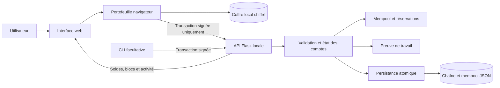
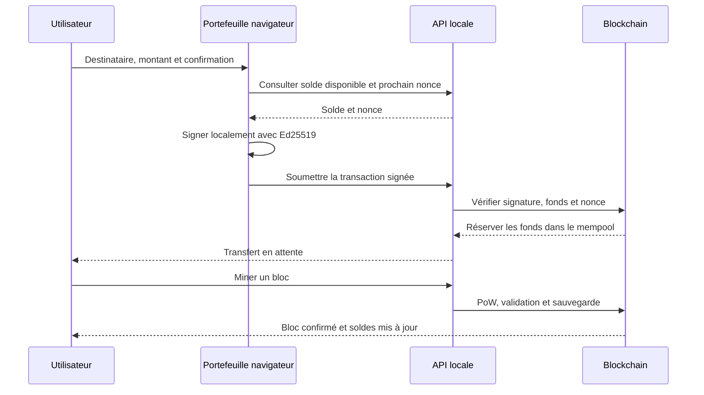

<div align="center">

# Makutachain

**Une blockchain indépendante. Une monnaie native. Une expérience accessible.**

Makutacoin · **MTC** · Python · Ed25519 · SHA-256 · Proof of Work

[Découvrir](#présentation) · [Démarrer](#démarrage-rapide) · [Architecture](#architecture) · [Démonstration](#premier-parcours) · [Documentation](#documentation)

</div>

---

## Présentation

Makutachain est un projet académique de blockchain indépendante développé en Python.
Il implémente sa propre chaîne de blocs et sa monnaie native, **Makutacoin (MTC)**,
avec une interface web permettant de créer des portefeuilles, signer des transferts
et explorer le réseau local.

L'objectif est de rendre observables les mécanismes essentiels d'une blockchain :
chaînage cryptographique, signatures, soldes, prévention des doubles dépenses,
preuve de travail et règles d'émission.

> **Périmètre : prototype pédagogique local.** Le projet ne comporte pas de réseau
> P2P, de consensus distribué ni de compatibilité Ethereum/EVM. Les MTC n'ont pas
> de valeur marchande affichée. Ce logiciel n'est pas destiné à gérer des fonds réels.

## Fonctionnalités

| Domaine | Implémentation |
|---|---|
| Chaîne | Genesis déterministe, blocs liés et hash SHA-256 canonique |
| Transactions | Signatures Ed25519, identifiants déterministes, identité réseau signée |
| Comptes | Soldes entiers, nonces séquentiels, fonds réservés dans le mempool |
| Minage | Proof of Work pédagogique, preuve vérifiée à la validation |
| Émission | Récompenses contrôlées et offre plafonnée à 10 000 MTC |
| Persistance | JSON versionné, remplacement atomique, revalidation au démarrage |
| Portefeuilles web | Création, chiffrement, sauvegarde, restauration et signature locale |
| Interface | Accueil, tableau de bord décisionnel, portefeuilles, envoi, réception, minage et explorateur |
| API | Flask, erreurs structurées, session navigateur et accès CLI par jeton |
| Vérification | Tests unitaires, intégration, sécurité, concurrence et Web Crypto/Python |

### Politique monétaire

| Paramètre | Valeur |
|---|---|
| Monnaie | Makutacoin |
| Symbole | MTC |
| Unité | 1 unité interne = 1 MTC entier |
| Offre initiale | 0 MTC |
| Offre maximale | 10 000 MTC |
| Récompense | 10 MTC par bloc, dans la limite du plafond |
| Frais de transfert | 0 MTC |

Seules les récompenses autorisées par le protocole émettent des MTC. Les fractions,
les montants nuls ou négatifs et les dépenses excédant le solde confirmé disponible
sont refusés. La récompense disparaît une fois le plafond atteint.

## Démarrage rapide

### Prérequis

- Ubuntu/Linux avec Python **3.11 ou supérieur** et le module `venv`.
- Un navigateur récent disposant de Web Crypto et d'Ed25519.
- Node.js **22 ou supérieur** pour exécuter aussi les tests Web Crypto ; il n'est
  pas nécessaire pour lancer l'application.
- Internet pour l'installation initiale des dépendances ; l'application fonctionne
  ensuite sans service externe.

### Installation

```bash
git clone https://github.com/Merciel01/makutachain.git
cd makutachain
python3 -m venv .venv
.venv/bin/python -m pip install -r requirements.lock.txt
./scripts/run.sh
```

Ouvrir **http://127.0.0.1:5000**. Le serveur écoute exclusivement sur localhost,
avec le débogueur désactivé. Laisser le terminal ouvert pendant l'utilisation.
Pour arrêter : **Ctrl+C**.

Le fichier `requirements.lock.txt` fixe les versions des dépendances utilisées.
Les contraintes générales du projet figurent dans `pyproject.toml`.

## Premier parcours

Toutes les opérations suivantes se font dans le navigateur :

1. Ouvrir le menu à trois barres, puis **Portefeuilles**.
2. Créer **Alice**, choisir un mot de passe d'au moins 12 caractères et télécharger
   sa sauvegarde chiffrée. Créer et sauvegarder **Bob** de la même manière.
3. Choisir **Alice** comme portefeuille actif et ouvrir **Minage**. Miner un bloc :
   Alice reçoit **10 MTC**.
4. Dans **Portefeuilles**, déverrouiller Alice. Dans **Envoyer**, choisir Bob,
   saisir **4 MTC**, vérifier le récapitulatif et confirmer.
5. Choisir **Bob** comme portefeuille actif, puis miner un bloc pour confirmer
   le transfert. Sur cette chaîne neuve : **Alice = 6 MTC**, **Bob = 14 MTC**.
6. Consulter les transactions et les blocs dans **Explorateur**.

Les clés privées et les mots de passe restent dans le navigateur. Le serveur
reçoit les transactions déjà signées. Conserver les sauvegardes chiffrées et leurs
mots de passe : sans eux, un portefeuille effacé ne peut pas être restauré.

Le [guide de l'interface](docs/interface.md) détaille la réception, le verrouillage
et la restauration des portefeuilles.

## Tableau de bord décisionnel

Le menu **Tableau de bord** présente une lecture du réseau entier : émission des
MTC, volume des transferts et adresses actives sur 24 heures, saturation de la file
d'attente, activité des 20 derniers blocs et répartition des soldes. Les
récompenses sont exclues du volume transféré ; une adresse active ne représente
pas nécessairement une personne. Les graphiques n'affichent aucun cours de marché.

L'API calcule ces indicateurs depuis un même instantané validé. La page s'actualise
automatiquement ; une panne signale les chiffres comme anciens sans inventer un
solde nul. Les définitions sont dans [le guide de l'interface](docs/interface.md).

## MakutaWallet — extension locale

MakutaWallet **v0.1.3** permet de conserver les clés séparément du site,
d'autoriser la connexion et de confirmer chaque transfert dans sa propre fenêtre.
Le portefeuille actuel du site reste disponible. Chrome/Chromium récent (137+)
est requis ; cette version n'est pas publiée sur le Chrome Web Store.

Charger le dossier `extension/makutawallet` dans `chrome://extensions` en mode
développeur, créer/restaurer un portefeuille puis actualiser le site et cliquer
**Connecter MakutaWallet**. La sauvegarde chiffrée du site est compatible.
Consulter le [guide complet](docs/makutawallet.md) pour l'installation et les limites.

Le clic sur l'icône ouvre une fenêtre durable. Les soldes du site et de
l'extension sont actualisés automatiquement, environ toutes les cinq secondes
lorsqu'ils sont visibles, et au retour du focus. Adresse, réseau et heure de
lecture permettent de comparer le même compte. Chaque signature reste soumise
à une confirmation explicite et au mot de passe dans l'extension.

```bash
# Facultatif : générer un ZIP pour installation locale
.venv/bin/python scripts/build_makutawallet.py
# Contrôles spécifiques de l'extension (également appelés par pytest si Node existe)
node tests/test_extension.mjs
```

Le moteur et les signatures sont couverts par les tests. Le parcours réel dans
Chrome nécessite encore une vérification manuelle ; ce prototype n'a pas d'audit
indépendant et n'est pas destiné aux fonds réels.

### Démonstration avec le tunnel HTTPS

MakutaWallet autorise aussi l'origine précise
`https://30l3n0cw-5000.uks1.devtunnels.ms`. Pour activer cette origine sur le
serveur, lancer :

```bash
MAKUTACHAIN_TUNNEL_ORIGIN=https://30l3n0cw-5000.uks1.devtunnels.ms ./scripts/run.sh
```

Recharger l'extension puis actualiser le site. Sans cette variable, le serveur
conserve son accès local par défaut. L'extension lit l'API sans cookies de
connexion Microsoft/GitHub : un tunnel privé nécessite une solution
d'authentification supplémentaire. Un port public permet la démonstration, avec
accès aux fonctions publiques, dont le minage. Voir [le guide MakutaWallet](docs/makutawallet.md).

## Architecture



### Organisation du code

```text
makutachain/
├── mithimbochain/          # Moteur Python ; nom historique conservé
│   ├── protocol.py        # Constantes, JSON canonique et SHA-256
│   ├── block.py           # Blocs, en-têtes et Genesis
│   ├── transaction.py     # Adresses, signatures et récompenses
│   ├── blockchain.py      # Relecture intégrale, soldes et application de l'état
│   ├── consensus.py       # Recherche et vérification de la PoW
│   ├── mempool.py         # Transactions en attente et réservations
│   ├── storage.py         # Sauvegarde atomique et chargement validé
│   ├── wallet.py          # Portefeuilles CLI locaux
│   ├── api.py             # API REST et protections locales
│   └── __main__.py        # Commandes et lancement du serveur
├── web/                   # HTML, CSS et JavaScript natifs, sans compilation
│   ├── index.html         # Écrans et formulaires
│   ├── style.css          # Palette, mise en page et adaptation mobile
│   ├── app.js             # Démarrage, navigation et menu
│   ├── interface.mjs      # Interactions et échanges avec l'API
│   └── wallet.mjs         # Cryptographie et coffre côté navigateur
├── extension/makutawallet/ # Extension Chrome locale : coffre et autorisations
├── tests/                 # Tests Python et contrôles Web Crypto/extension
├── docs/                  # Documentation technique et guides
├── scripts/               # Lancement et démonstration isolée
├── .github/workflows/     # Vérification automatisée sur GitHub
├── pyproject.toml
└── requirements.lock.txt
```

**Compatibilité historique.** L'application s'appelle Makutachain, mais le paquet
Python `mithimbochain`, l'identité signée `mithimbochain-local-v1` et les clés de
stockage internes conservent leur nom historique. Cela préserve les blocs,
portefeuilles et signatures existants. Les modifier exige une migration de protocole.

### Parcours d'un transfert



Les soldes et nonces sont reconstruits depuis Genesis au chargement. Une opération
API modifie une copie de la chaîne, sauvegarde cette copie, puis publie l'état en
mémoire. Les règles complètes figurent dans le [protocole](docs/protocole.md).

## Tests et démonstration automatique

```bash
# Suite complète, y compris Web Crypto si Node est disponible
.venv/bin/python -m pytest -q

# Démonstration dans un stockage temporaire isolé
PYTHONPATH=. .venv/bin/python scripts/demo.py

# Contrôle de syntaxe du frontend
node --check web/app.js
node --check web/interface.mjs
node --check web/wallet.mjs
```

La démonstration vérifie les soldes Alice/Bob, la relecture du stockage et le rejet
d'un ancien bloc falsifié. Elle ne modifie pas les données du serveur actif.
Sans Node, le test croisé Web Crypto est indiqué comme ignoré par pytest.
Le [journal](docs/avancement.md) consigne les commandes et résultats réellement observés.

## API REST

| Méthode | Route | Fonction |
|---|---|---|
| GET | `/api/chain` | Exporter la chaîne |
| GET | `/api/blocks` | Lister les blocs |
| GET | `/api/blocks/<index>` | Consulter un bloc |
| GET | `/api/transactions` | Consulter les transactions confirmées et en attente |
| POST | `/api/transactions` | Soumettre une transaction signée |
| GET | `/api/balance/<address>` | Solde confirmé, réservé, disponible et prochain nonce |
| POST | `/api/mine` | Miner un bloc |
| GET | `/api/validate` | Valider la chaîne |
| GET | `/api/dashboard` | Indicateurs décisionnels du réseau |
| GET | `/api/stats` | Consulter les statistiques |
| POST | `/api/session` | Ouvrir la session locale du navigateur |

L'interface gère sa session automatiquement. Les clients CLI peuvent utiliser le
jeton local dans `data/api.token`. Les contrats, exemples et statuts d'erreur sont
décrits dans la [documentation API](docs/api.md).

## Données et sécurité

- **Navigateur** : clés chiffrées par AES-256-GCM, avec une clé dérivée du mot de
  passe par PBKDF2-SHA256 ; signatures Ed25519 locales.
- **Serveur** : chaîne et mempool dans `data/chain.json`, revalidés au démarrage.
- **Accès** : localhost par défaut, tunnel HTTPS précis sur activation explicite, contrôles d'origine, session HttpOnly/SameSite
  et autorisation des opérations sensibles.
- **Dépôt public** : aucun portefeuille privé, jeton API, fichier d'environnement
  ni donnée de chaîne utilisateur n'est inclus.

Utiliser toujours la même URL : `localhost` et `127.0.0.1` ont des stockages
navigateur distincts. Les anciens fichiers de portefeuille CLI `.key` sont privés
et non chiffrés ; ils ne sont pas des sauvegardes JSON du portefeuille navigateur.

La faible difficulté et l'absence de réseau distribué rendent ce prototype impropre
à un usage financier réel. Un navigateur compromis peut aussi compromettre un
portefeuille déverrouillé. Lire les [limites de sécurité](docs/securite.md).

## Dépannage

| Symptôme | Action |
|---|---|
| Module Python absent | Utiliser `.venv/bin/python` et réinstaller le verrou |
| Port déjà occupé | Arrêter l'autre service ou choisir `--port 5001` |
| Chaîne déjà utilisée | Arrêter l'autre instance ; changer de port ne libère pas le verrou |
| Page figée après une mise à jour | Arrêter/reprendre le serveur, puis actualiser avec Ctrl+Maj+R |
| Portefeuille verrouillé | Le déverrouiller dans le menu Portefeuilles |
| Mot de passe perdu | Aucun mécanisme de récupération sans mot de passe |
| Stockage corrompu | Arrêter le serveur et restaurer une sauvegarde valide ; ne pas écraser les données |

Pour une instance distincte :

```bash
./scripts/run.sh --port 5001 --data data/autre-chain.json --token-file data/autre.token
```

## Documentation

| Document | Contenu |
|---|---|
| [Architecture](docs/architecture.md) | Composants, flux, concurrence et persistance |
| [Protocole](docs/protocole.md) | Genesis, sérialisation, signatures et règles de consensus |
| [Sécurité](docs/securite.md) | Protections et limites connues |
| [API](docs/api.md) | Routes, authentification, requêtes et réponses |
| [MakutaWallet](docs/makutawallet.md) | Extension locale, installation et confirmations de signature |
| [Interface](docs/interface.md) | Parcours utilisateur sans commandes techniques |
| [Démonstration](docs/demonstration.md) | Scénario reproductible et vérifications |
| [Avancement](docs/avancement.md) | État des jalons et résultats observés |
| [Contribution](CONTRIBUTING.md) | Préparer une modification et la vérifier |

## Évolutions possibles

- Vérification visuelle automatisée des parcours navigateur.
- Pagination de l'explorateur et amélioration des performances de relecture.
- Migration explicite des noms internes historiques.
- Réseau P2P et sélection de branche, dans un travail distinct sur le consensus.

Ces éléments sont des pistes et ne sont pas présentés comme implémentés.
