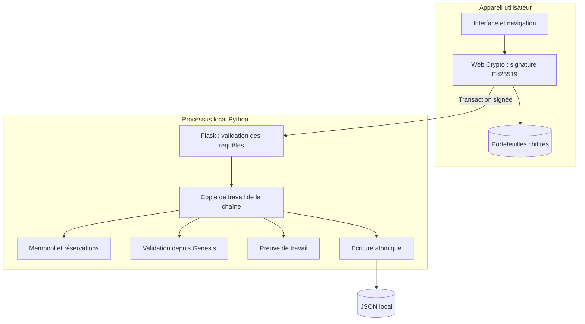

# Architecture de Makutachain

Le navigateur (ou la CLI facultative) détient les clés Ed25519 et produit des transactions signées. Le
serveur Flask reçoit uniquement les transactions publiques, valide le protocole,
applique les opérations à une copie de l'état, sauvegarde cette copie, puis
publie le nouvel état en mémoire. Un échec d'écriture avant remplacement ne
publie pas l'opération. Le navigateur fournit un parcours de création, réception, transfert et minage. Il soumet les transactions signées automatiquement.

| Module | Responsabilité |
|---|---|
| protocol.py | Constantes réseau, JSON canonique, SHA-256, erreurs |
| block.py | En-tête, engagement des transactions, Genesis et import strict |
| transaction.py | Adresses, signatures, identifiants, récompenses |
| wallet.py | Génération et signature locales ; fichiers privés mode 600 |
| consensus.py | Recherche et vérification de preuve de travail |
| blockchain.py | Relecture intégrale, comptes, émission et opérations |
| mempool.py | Réservations sur fonds confirmés et nonces contigus |
| storage.py | Remplacement atomique et revalidation au chargement |
| api.py | Routes REST, authentification et erreurs sans traces |
| __main__.py | CLI, verrou du serveur et jeton local |
| web/ | Tableau de bord, soldes, explorateur, soumission et minage |

L'état des soldes et des nonces est dérivé depuis Genesis, jamais accepté depuis
un fichier externe. Chaque bloc engage le hash canonique de toutes ses transactions.
Les lectures et mutations API sont sérialisées par un verrou de thread ; les
opérations de chaîne disposent aussi d'un verrou réentrant. Le lancement CLI
prend un verrou POSIX exclusif sur le fichier de données. Une seule instance et
un seul processus sont pris en charge ; ne pas utiliser plusieurs workers WSGI.

Le stockage est un unique JSON versionné. Écriture dans un fichier temporaire du
même dossier, flush, fsync, remplacement atomique, puis fsync du répertoire. Les
fichiers temporaires sont nettoyés en cas d'échec. La relecture intégrale à chaque
minage privilégie la lisibilité et la vérification à la performance.

## Portefeuille navigateur

`web/wallet.mjs` isole les fonctions cryptographiques : JSON canonique compatible
Python, génération Ed25519, dérivation d'adresse, chiffrement du PKCS#8 avec
AES-256-GCM, restauration et signature. PBKDF2-SHA256, 310 000 itérations, sel de
16 octets et IV aléatoire de 12 octets. Les métadonnées publiques sont authentifiées
comme données additionnelles. La clé déverrouillée est importée non exportable.

`web/app.js` initialise la navigation et affiche les erreurs de chargement.
`web/interface.mjs` gère les six menus, les fichiers de sauvegarde chiffrés, le stockage
local, le portefeuille actif, l'expiration du déverrouillage et la confirmation
explicite des transferts. Le nonce est obtenu auprès du serveur juste avant la
signature. La validation serveur et les réservations restent obligatoires.

Une session navigateur de huit heures utilise une capacité aléatoire propre au
processus, dans un cookie HttpOnly / SameSite Strict limité à `/api`. Le bootstrap
et les mutations par cookie exigent une Origin exacte et un en-tête personnalisé.
Les clients CLI continuent à utiliser le Bearer token. Aucun secret de portefeuille
n'est transmis au bootstrap.
