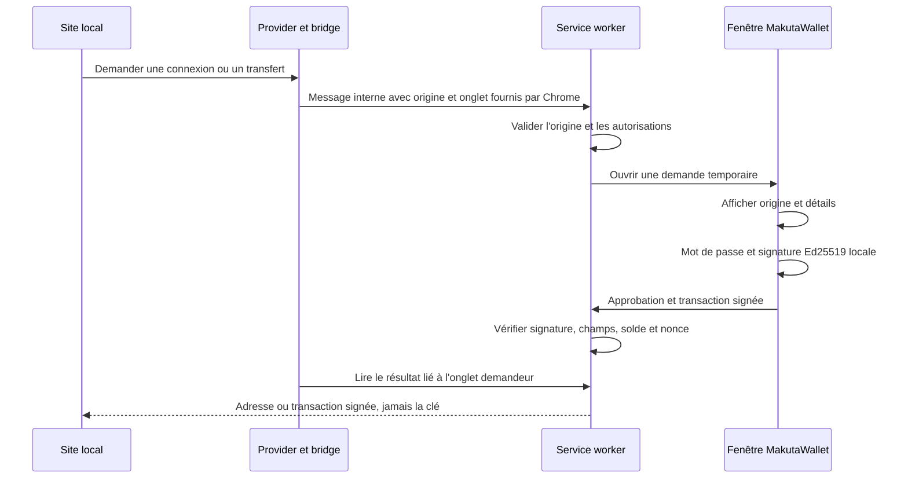

# MakutaWallet — extension locale v0.1.2

MakutaWallet est le portefeuille d'extension de Makutachain. Cette première version
cible Chrome/Chromium 137+ sur ordinateur et le réseau local. Le portefeuille
intégré au site reste disponible, sans migration de chaîne ni modification des MTC.
L'extension n'est pas publiée sur le Chrome Web Store ni auditée pour gérer des
fonds réels.

## Installer

1. Arrêter et relancer le serveur après cette mise à jour : `./scripts/run.sh`.
2. Ouvrir `chrome://extensions` dans Chrome/Chromium et activer **Mode développeur**.
3. Cliquer **Charger l'extension non empaquetée**, puis choisir le dossier du projet
   `extension/makutawallet` (pas le dossier racine du projet).
4. Épingler MakutaWallet via le bouton Extensions du navigateur.
5. Cliquer sur l’icône MakutaWallet pour ouvrir sa fenêtre durable, puis créer un portefeuille et télécharger sa sauvegarde, ou
   restaurer un fichier JSON chiffré sauvegardé depuis le portefeuille du site.
6. Actualiser Makutachain puis cliquer **Connecter MakutaWallet**. Autoriser la
   connexion dans la fenêtre de l'extension après vérification de l'origine.

Le guide est également accessible depuis **Portefeuilles**, ou à
`http://127.0.0.1:5000/makutawallet` après redémarrage du serveur.

Un paquet ZIP est généré avec :

```bash
.venv/bin/python scripts/build_makutawallet.py
```

Le résultat est `dist/makutawallet.zip`. L'extraire puis charger son dossier
`makutawallet`. Le ZIP ne contient que les onze fichiers exécutables nécessaires ;
il est exclu de Git et peut être téléchargé via le guide si sa génération a été
faite. Après modification des sources : reconstruire le ZIP, recharger l'extension
sur `chrome://extensions`, puis actualiser le site.

## Utiliser

- **Solde et réception** : l'extension affiche l'adresse publique, permet de la
  copier et de consulter le solde disponible/confirmé/réservé.
- **Minage** : une fois connecté, choisir MakutaWallet comme portefeuille actif
  sur le site et miner ; la récompense crédite cette adresse.
- **Envoi** : préparer le transfert sur le site, vérifier son récapitulatif,
  puis vérifier et signer dans MakutaWallet. Le site transmet la transaction
  signée et le minage la confirme. L'extension ne transmet pas directement de POST
  à l'API et n'a pas de jeton de minage.
- **Sauvegarde** : format chiffré compatible avec le portefeuille navigateur du
  site. Restaurer la même sauvegarde conserve exactement la même adresse et les
  mêmes soldes. Aucune nouvelle émission n'est créée par une restauration.
- **Changement de compte** : révoque les autorisations des sites. Reconnecter le
  site pour utiliser le nouveau compte. Si le même portefeuille est aussi dans
  le site, MakutaWallet est le signataire tant qu'il reste connecté.
- **Déconnexion** : bouton Déconnecter du site, ou Déconnecter tous les sites
  dans l'extension. Les fonds restent dans la chaîne.

Chaque signature nécessite le mot de passe dans la fenêtre de l'extension. Il
n'y a pas de session de clé déverrouillée persistante : le coffre est verrouillé
entre les signatures. Les demandes expirent après deux minutes ; refus, fermeture
de fenêtre et navigation/fermeture de l'onglet annulent les demandes en attente.
Une transaction déjà remise au site ne peut pas être annulée par une déconnexion.

## Réseaux autorisés

Uniquement `http://127.0.0.1:5000`, `http://localhost:5000` et les mêmes hôtes sur
le port `5001`. Les autres origines, ports et iframes sont refusés. Les permissions
hôte Chrome sont limitées aux deux hôtes loopback ; les ports sont contrôlés par
le code car les motifs de correspondance ne fournissent pas cette restriction.
Avant une signature, l'extension vérifie l'identité fixe `mithimbochain-local-v1`,
le solde et le nonce depuis l'API du site demandeur.

## Architecture



| Fichier | Responsabilité |
|---|---|
| manifest.json | Manifest V3, permissions locales et scripts déclarés |
| provider.js | API publique `window.makutawallet` dans la page |
| bridge.js | Transport borné entre page et service worker |
| background.mjs | Contrôles d'émetteur, sérialisation et accès aux API Chrome |
| engine.mjs | Autorisations, demandes, expiration et vérification des signatures |
| popup.html/css/mjs | Création/restauration, soldes et confirmations explicites |
| window-controller.mjs | Fenêtre durable, réutilisation et remise au premier plan |
| wallet.mjs | Copie assemblée du module cryptographique commun du site |

Le service worker ne déchiffre jamais de clé. Le mot de passe et la clé déchiffrée
restent dans la fenêtre de l'extension pendant l'opération. Seuls les coffres
chiffrés et les autorisations sont enregistrés dans `chrome.storage.local`.
Les demandes et résultats publics temporaires résident dans `storage.session`,
pour résister à la suspension du service worker sans conserver de clé privée.
Ces deux zones sont limitées aux contextes de confiance de l'extension.
Aucune ressource n'est déclarée web-accessible ; aucun script distant n'est chargé.

### API du provider

```javascript
const [address] = await window.makutawallet.request({
  method: 'makuta_requestAccounts'
});
const tx = await window.makutawallet.request({
  method: 'makuta_signTransaction',
  params: {sender: address, recipient: adresseDestinataire, amount: 4}
});
```

`makuta_accounts` retourne uniquement les adresses déjà autorisées pour l'origine.
`makuta_disconnect` révoque cette origine. Aucune méthode de signature arbitraire,
d'export de clé privée ou d'accès au coffre n'est exposée au site.

## Tests et limites

```bash
.venv/bin/python -m pytest -q
node tests/test_extension.mjs
```

Les tests Node contrôlent les autorisations, les émetteurs, la liaison à l'onglet,
la signature, les champs modifiés, le nonce, les refus, les annulations,
l'expiration et la reprise du moteur. Le test Python vérifie aussi qu'une
transaction délivrée par le moteur de l'extension est acceptée par le consensus.

Ces tests n'émulent pas Chrome. Le chargement de Manifest V3, le transport réel
entre mondes JavaScript, l'ouverture des fenêtres et le parcours graphique doivent
encore être vérifiés manuellement dans le navigateur. Aucune réussite de ce
parcours n'est revendiquée sans cette vérification. Tester d'abord sur la chaîne
pédagogique locale, avec des sauvegardes.

Un navigateur compromis, une extension malveillante ou une interface de signature
compromise peut mettre les clés en danger. La connexion seule n'autorise aucune
signature, mais un site peut conserver une transaction une fois signée. Toujours
vérifier le destinataire et le montant dans l'extension ; une transaction signée
ne peut pas être révoquée cryptographiquement par un simple clic Déconnecter.
Pas de phrase mnémonique, matériel, EVM/MetaMask, réseau distant ou publication
sur un magasin d'extensions dans cette version.

Références techniques primaires : [messagerie Chrome](https://developer.chrome.com/docs/extensions/develop/concepts/messaging),
[stockage et niveaux d'accès](https://developer.chrome.com/docs/extensions/reference/api/storage),
[cycle de vie des service workers](https://developer.chrome.com/docs/extensions/develop/concepts/service-workers/lifecycle).

## Fenêtre qui disparaît ou ancienne version

Depuis la version 0.1.1, l'icône ouvre une fenêtre durable, et non une popup de
barre d'outils. Elle reste visible lorsque le navigateur perd le focus et après
une approbation ou un refus. Un second clic remet cette même fenêtre au premier
plan ; les demandes de signature y sont aussi affichées.

Après mise à jour, ouvrir `chrome://extensions`, puis cliquer **Recharger** sur
la fiche MakutaWallet (sans supprimer l'extension), et actualiser le site. Si
l'extension a été installée depuis une copie extraite du ZIP, actualiser les
fichiers de cette copie avant de la recharger. Recharger conserve les coffres
chiffrés mais annule les demandes temporaires. Ne pas désinstaller l'extension
sans avoir téléchargé les sauvegardes.

## Synchronisation des soldes (v0.1.2)

Le site et la fenêtre MakutaWallet relisent automatiquement leurs soldes environ
toutes les cinq secondes lorsqu'ils sont visibles, ainsi qu'au retour du focus.
Les lectures automatiques sont suspendues pendant les opérations ; elles ne
modifient pas le portefeuille ni les règles de consensus. Aucun solde n'est stocké
comme autorité dans le coffre : la chaîne locale reste la source de vérité.

Les deux écrans affichent le **disponible**, et distinguent **confirmé** et
**réservé**. L'adresse, l'origine du serveur, l'heure de dernière lecture et la
hauteur de bloc permettent de comparer le même contexte. Si le serveur ne répond
plus, un tiret et une indication d'indisponibilité remplacent le chiffre ; une
panne n'est jamais transformée en solde nul. Une requête ancienne ne peut pas
remplacer le résultat d'une lecture plus récente ou d'un autre compte.

Changer de compte dans l'extension révoque les autorisations précédentes. Le site
détecte cette révocation et demande une reconnexion au lieu de continuer à
présenter l'ancienne adresse comme connectée. Après changement, cliquer
**Connecter MakutaWallet**, vérifier l'adresse dans l'extension puis confirmer.
La connexion conserve aussi l'origine du site pour la consultation de solde de
l'extension. Un autre réseau peut être choisi explicitement dans l'extension.

Pour comparer : vérifier l'adresse complète, le même hôte/port, puis les valeurs
confirmé/réservé/disponible. Deux comptes différents ou deux serveurs locaux
peuvent légitimement avoir des soldes différents. Le rafraîchissement périodique
n'est pas une diffusion instantanée : une modification peut mettre quelques
secondes à apparaître sur l'autre écran.

## Démonstration via le tunnel HTTPS (v0.1.3)

L'extension autorise aussi exactement cette origine :
https://30l3n0cw-5000.uks1.devtunnels.ms

Le manifeste, le provider, le pont, le moteur et le sélecteur sont alignés sur
cette adresse. Aucun joker ne permet les autres tunnels. Si le tunnel change
d'adresse, il faut adapter ces listes explicitement et recharger l'extension.

Pour autoriser cette origine sur le serveur, arrêter l'ancienne instance puis
relancer dans le dossier du projet :

```bash
MAKUTACHAIN_TUNNEL_ORIGIN=https://30l3n0cw-5000.uks1.devtunnels.ms ./scripts/run.sh
```

Sans cette variable, le serveur reste limité aux origines locales. Les requêtes
doivent toujours arriver au serveur depuis loopback (proxy de forwarding local).
Le serveur ne fait pas confiance à X-Forwarded-For pour contourner cette règle.
Les sessions créées par l'origine HTTPS portent un cookie Secure ; les signatures,
les nonces, les autorisations par site et l'identité de chaîne restent vérifiés.

Dans Chromium, recharger MakutaWallet depuis chrome://extensions, accepter les
nouvelles permissions si nécessaire, puis actualiser le site du tunnel.
Sélectionner son réseau dans la fenêtre ou cliquer sur « Connecter MakutaWallet »
depuis ce site et autoriser la connexion. Le serveur de données reste le même :
l'adresse de tunnel est un autre accès, pas une nouvelle blockchain.

L'extension lit l'API sans cookies de connexion Microsoft/GitHub. Pour une
démonstration sans jeton de tunnel, le port doit donc être accessible publiquement
dans les réglages Ports de VS Code. En mode privé, un accès navigateur connecté
ne suffit pas à autoriser les lectures de l'extension. Le lien public donne accès
aux fonctions de démonstration, notamment au minage ; conserver cet usage pour
les comptes de test. Les clés des portefeuilles ne sont pas envoyées au tunnel.

Les requêtes de lecture de l'extension demandent application/json pour recevoir
l'API plutôt que la page intermédiaire du tunnel. La connexion Chromium réelle
doit être vérifiée après rechargement : les tests locaux simulent le proxy.
